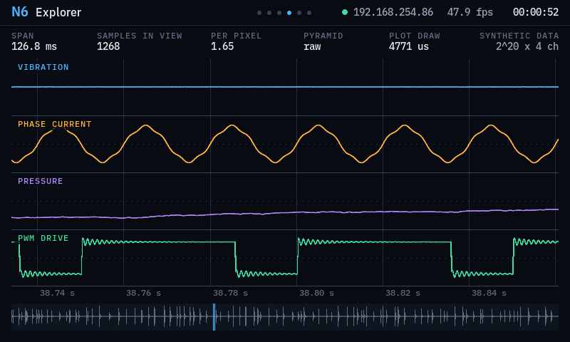
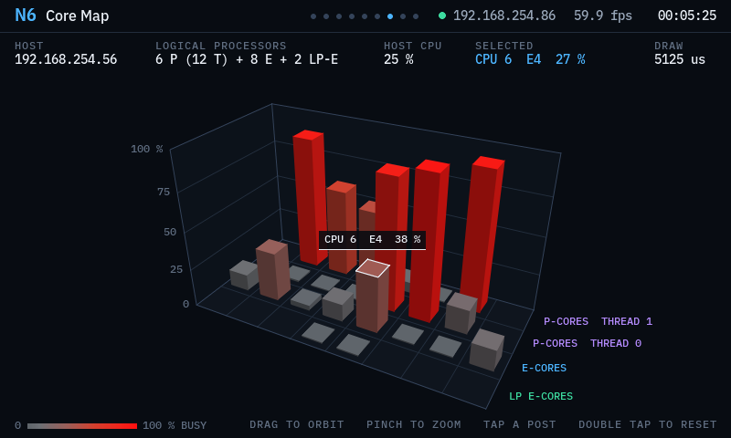
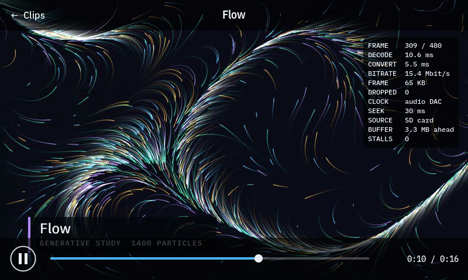
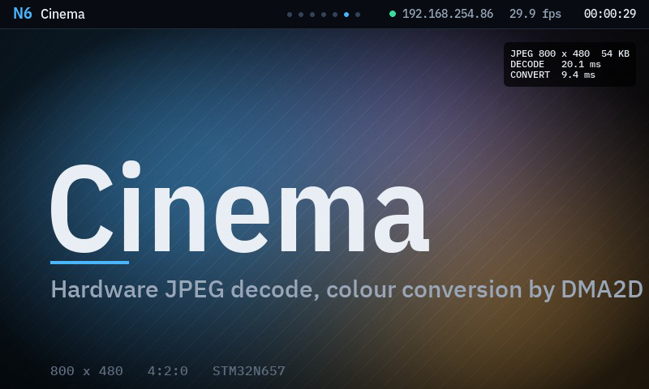

# stm32n6-demo

A multi-screen touch demo for the **STM32N6570-DK**: live dashboards, dense
real-time data visualization, and full-screen video with sound, built on
Zephyr 4.4.0 and LVGL 9.5. The audience is engineers and UX designers, so the
rules are: lock to the panel refresh, no fake data, and show the measurements.

> **Status: nine screens, video playback and audio output work on hardware.**
> Every screen holds the panel's 59.98 Hz with no dropped frames in the
> automated run, a 48 s original film plays at 30 fps with stereo sound from
> flash or from a microSD card, clips upload to the card over Ethernet at
> 2 to 4 MB/s while the demo runs, and touch, motion, colour and sound have been
> checked by hand (the card path by measurement only, so far). Left alone
> for 90 seconds it tours itself. Not built yet: microphone input. See
> [Status](#status).

| | |
|---|---|
|  |  |
|  |  |
|  |  |

Screenshots are the board's own frame buffer, read back over Ethernet.
The plan, with architecture, budgets, phases and risks, is in
[`docs/plan.html`](docs/plan.html).

## Hardware

| Part | Detail |
|---|---|
| Board | STM32N6570-DK (MB1939), STM32N657X0, Cortex-M55 at 800 MHz with Helium |
| Display | 5 inch 800 x 480 RGB888 panel on LTDC, GT911 5-point capacitive touch |
| Memory | 4.2 MB internal SRAM, 32 MB HexaSPI PSRAM, 128 MB octal NOR (XSPI2) |
| Storage | microSD slot on SDMMC2, 4-bit; optional (a 32 GB FAT32 card here) |
| Network | Gigabit Ethernet, RTL8211F PHY (RGMII) |
| Audio | WM8904 codec to the headphone jack, MEMS microphone on MDF |
| Probe | On-board ST-LINK V3EC, virtual COM port (COM17 on this host) |

## Prerequisites

- Windows 10/11, Python 3.10+, Git, CMake, Ninja
- Zephyr SDK 1.0.1 (`arm-zephyr-eabi`)
- STM32CubeProgrammer 2.18 or later (provides `STM32_Programmer_CLI`, the
  signing tool and the `MX66UW1G45G_STM32N6570-DK` external loader)
- ffmpeg (video asset pipeline, later phases)

## Setup

```powershell
git clone https://github.com/murr2k/stm32n6-demo.git
cd stm32n6-demo
python -m venv .venv
.\.venv\Scripts\python.exe -m pip install west pyserial pillow numpy
.\.venv\Scripts\west.exe init -l app
.\.venv\Scripts\west.exe update
.\.venv\Scripts\python.exe -m pip install -r zephyr\scripts\requirements-base.txt `
    -r bootloader\mcuboot\scripts\requirements.txt
```

The project root is the west workspace (manifest in `app/west.yml`, pinned to
Zephyr `v4.4.0`). `zephyr/`, `modules/` and `bootloader/` are fetched, not
committed.

## Build, flash, run

Leave the boot switches at **BOOT1 = H, BOOT0 = L** (development boot). The
whole loop then runs unattended:

```powershell
.\n6.cmd go                 # build + flash + power-cycle + start + console
.\n6.cmd go -p              # same, pristine build (needed after adding a .overlay or .conf file)
.\n6.cmd go --app-only      # skip reflashing MCUboot
.\n6.cmd run --secs 20      # restart what is in flash and watch the console
.\n6.cmd console            # just listen on the serial console
.\shot.cmd --host <ip>      # save the board's frame buffer to captures\shot.png
```

`n6.cmd` wraps `tools/n6.py`:

1. `build`: `west build --sysbuild -b stm32n6570_dk`, producing MCUboot (the
   first-stage boot loader, ST-signed) and the application (MCUboot-signed,
   executes in place from XSPI flash).
2. `flash`: power-cycles the target through the ST-LINK, then writes MCUboot
   to `0x7000_0000` and the app to slot 0 with ST's external loader over SWD.
3. `run`: power-cycles again, loads MCUboot into RAM over SWD and starts it.
   MCUboot validates slot 0 and jumps to the app.

For stand-alone use (no PC), set **BOOT1 = L** and power-cycle: the boot ROM
then loads MCUboot from flash by itself.

### Why the power cycles

ST's external loader leaves the NOR flash in octal DTR mode. A pin reset does
not undo that, and Zephyr's XSPI flash driver then stalls on its first
SPI-mode command (`XSPI reset enable (SPI/STR) failed`, MCUboot aborts). Only
removing power returns the flash to SPI mode. The ST-LINK V3EC can switch the
target supply, so `STM32_Programmer_CLI --power off/on` does it without a
finger on the board. The loader has the mirror-image problem: it only works
against the boot ROM's idle state, not against running firmware.

## Host Link and Core Map

```powershell
.\.venv\Scripts\python.exe -m pip install psutil    # once
.\run.cmd                                           # or: run.cmd --host <board ip>
```

`run.cmd` starts `host/companion.py`, which sends this PC's per-core CPU
load, memory use and network throughput to the board ten times a second and
times the board's reply to each datagram. On Windows it also sends the
CPU's layout (which logical processors are P-cores, E-cores, low-power
E-cores and SMT siblings), which the Core Map uses for its floor plan; on
other systems the Core Map falls back to a plain grid. Only those aggregate
numbers leave the PC: no process names, no host name. It opens no listening
port (replies return on the socket it sends from), so there is no firewall
prompt. Without the companion both screens say they are waiting; they do not
show placeholder data.

The companion can be left running across board restarts. The board announces
its address (a gratuitous ARP) when DHCP assigns it; without that, Windows
kept a host that had been sending into the void from finding the board again
for up to a minute. Measured with the companion sending through a power
cycle: the board answered 0.1 s after it had its address.

## Remote control and automated review

The firmware listens on these ports (trusted LAN only, no authentication):

| Port | Purpose | Host tool |
|---|---|---|
| tcp/5555 | One frame of the display, captured at a frame boundary | `tools/shot.py` |
| tcp/5556 | Text commands: switch screen, start attract mode, which screen is up (`where`), frame statistics, inject touches, audio, video and clip-list status, open a clip | `tools/ctl.py` |
| udp/5557 | Host telemetry in, echo out | `host/companion.py` |
| tcp/5558 | Clips to and from the list on the microSD card: put (with CRC-32), list, delete, free space | `tools/n6v.py upload`, `ls`, `rm`, `df` |

```powershell
.\.venv\Scripts\python.exe tools\ctl.py "screen 2" stats
.\.venv\Scripts\python.exe tools\ctl.py "swipe 600 250 200 250 180" "tap 400 200"
.\.venv\Scripts\python.exe tools\tour.py        # every screen: stats, screenshots, gestures
```

`tour.py` is the regression check: it starts the companion, visits each
screen, measures frame time and dropped frames over five seconds, saves
screenshots to `captures/tour/`, then drives Touch Lab, Explorer and Core Map
with injected multi-touch (three contacts, pinches, a flick, an orbit, an
edge swipe), checks that 80 touch releases never change the screen, makes
ten screen changes, plays the film from flash and from the card, opens and
closes a clip three times, records what the DAC gets during a drag on the
slider, a pause and a resume and counts the discontinuities in it, uploads a
generated test clip to the card while
Signal Lab runs, plays it, seeks in it five times, scrolls the gallery,
deletes it again, and runs one lap of attract mode. About seven minutes; a
screenshot costs the UI one frame (an 18 ms copy to PSRAM), so none is taken
inside a measured window.

`fuzz_player.py` is the abuse test for the player: random scrubs with a
wandering finger, some starting at a screen edge, some with a second
contact, mixed with play, pause, back and re-open. It names every action
that costs the UI a frame or stalls playback, and a seed replays a run.

`acap.py` records up to three seconds of what the firmware hands to the DAC
(a copy into PSRAM, read back over the control port) as a WAV file, and with
`--clicks` counts the steps in it that do not belong to the signal. It is how
the sound of the slider is checked without ears.

The control port serves one client at a time and drops one that has been
silent for five seconds. `ctl.py` keeps a single connection open for a
whole script; a tool that opens a connection per command will exhaust the
board's sixteen TCP slots and find it unreachable for a while.

## Layout

```
app/                    Zephyr application (also the west manifest repo)
  boards/               devicetree overlay: memory map, 60 Hz timing, MAC
  src/platform/         display (gfx), touch, network, telemetry, PSRAM, remote control
  src/ui/               design tokens, fonts, shell, direct rasteriser
  src/dsp/              signal generator + FFT, Explorer dataset + pyramid
  src/media/            hardware JPEG decode, clip player, microSD card and upload service
  src/screens/          one file per screen
assets/                 font sources (IBM Plex, OFL)
media/film/             the original film, companion clips and soundtrack, as code
host/companion.py       PC telemetry sender for the Host Link screen (run.cmd)
tools/
  n6.py                 build / flash / run / console
  shot.py, ctl.py       screenshot and remote-control clients
  tour.py               automated review
  fuzz_player.py        random abuse of the video player through injected touches
  acap.py               record the DAC feed as a WAV file, count discontinuities
  gen_fonts.py          TTF to LVGL bitmap fonts (needs npm install in tools/fontconv)
  n6v.py                encode video clips; upload them to the card, or pack and flash them
  gdbrun.ps1            scripted ST-LINK gdbserver + GDB session for bring-up
docs/plan.html          the plan
captures/               screenshots and logs pulled off the board (not committed)
```

## Screens

| Screen | What it shows | Frame time, avg / worst |
|---|---|---|
| Home | A tile per screen; each thumbnail is drawn live by that screen's code | 5.4 / 6.4 ms |
| Flight Deck | Frame time, CPU share per thread, heaps, Ethernet rates: the board measuring itself | 2.9 / 7.9 ms |
| Signal Lab | Triggered scope, log-frequency spectrum with peak hold and cursor, waterfall; one 1024-point Helium FFT per frame (about 220 us) | 7.8 / 10.2 ms |
| Explorer | 2^20 samples x 4 channels with a min/max pyramid in PSRAM; pan, pinch, cursor, auto tour | 11.1 / 14.5 ms while it zooms, 3 ms at rest |
| Touch Lab | Five contacts with trails, crosshairs, distance, report rate, touch-to-swap time | 1.7 / 2.4 ms |
| Host Link | A PC's per-core CPU load as a scrolling heat map, memory, network throughput and datagram round-trip time, pushed over UDP by `run.cmd` | 6.7 / 10.0 ms |
| Core Map | The same PC's logical processors as posts on a floor plan of its chip (P-cores, E-cores, SMT threads), height and colour by load. Drag to orbit, pinch to zoom and pan, tap a post, double tap to reset. Software 3D: projected in floating point, filled as anti-aliased quads, no depth buffer | 6.8 / 7.7 ms; 12 ms with every post at 100 % |
| Cinema | Clips from flash and from the microSD card in a gallery that scrolls sideways; full screen with overlay controls, scrubbing (the picture follows the finger, the sound is cross-faded 85 ms pieces of the clip) and a stats panel (decode and conversion time, bit rate, seek time, read-ahead). Hardware JPEG decode about 10 ms a frame, DMA2D conversion 4.8 ms, video slaved to the audio clock | 30 fps video, no drops; a video frame costs the UI 6.2 ms, 9.2 ms with the controls up, 9.9 ms while scrubbing |
| Specimen | Type scale, colour tokens, motion test | 1.9 / 3.1 ms |

Frame time is all UI-thread work for a frame (screen logic, layout, render),
measured on the board over five seconds per screen by `tools/tour.py`. The
budget at 59.98 Hz is 16.67 ms. Host Link and Core Map are measured with the
companion running. The same run makes ten screen changes and a 150 s lap of
attract mode: no dropped frame in either, worst frame 14.3 ms.

Explorer is the screen closest to the budget, and it was over it until the
build was told about the FPU: the N657's Cortex-M55 has double precision, but
Zephyr 4.4.0 builds for single precision, so every `double` in the per-column
position maths was a library call (2 to 5 ms a frame). `app/Kconfig` selects
the double-precision FPU; the sample markers also stopped taking a square
root per pixel.

Signal Lab's source is a built-in signal generator and Explorer's dataset is
synthetic; both are labelled as such on screen. Everything on Flight Deck is
measured.

### Navigation, transitions, attract mode

Swipe in from the left or right edge to step between screens, tap a Home tile
to jump, tap the wordmark and title at the left of the bar to go back. The
USER button toggles a frame-time overlay.

A screen change is a 110 ms fade out, the swap, then a 200 ms fade in while
the new screen settles upwards by 10 px. The fade is not rendered: it is the
LTDC layer's constant alpha, reloaded at the vertical blank, over a
background colour that matches the theme. The frame that builds the new
screen is therefore drawn while the display is dark, and a transition costs
no frame time (blending a veil in software dropped a frame on every one).

After 90 seconds without a touch the demo runs itself: it steps through the
screens, lets Explorer finish its zoom tour, plays the film once in Cinema,
and skips screens that would show nothing (Host Link without a companion,
Touch Lab without fingers). The title bar says so while it does, and any
touch hands control back. `ctl.py attract` starts it immediately.

## Video and audio

Clips are Motion JPEG with 48 kHz stereo PCM in a small container (`.n6v`,
described in `app/src/media/player.h`). They live in two places: a media
partition of the XSPI flash at `0x7042_0000`, and `/clips` on a microSD card.

```powershell
.\.venv\Scripts\python.exe -m pip install skia-python     # once, for the film renderer
.\.venv\Scripts\python.exe media\film\n6_film.py          # render the 48 s film + soundtrack (about 12 minutes)
.\.venv\Scripts\python.exe media\film\n6_film.py --score-only   # new soundtrack, same picture (seconds)
.\.venv\Scripts\python.exe media\film\extras.py           # "Flow" and the A/V sync check
.\.venv\Scripts\python.exe tools\n6v.py encode any.mp4 -o media\out\clip.n6v --title "My clip" [--audio sound.wav]
# to the card, over Ethernet, while the demo runs: 84 MB in 22 s
.\.venv\Scripts\python.exe tools\n6v.py upload media\out\n6_film.n6v media\out\flow.n6v media\out\sync.n6v
.\.venv\Scripts\python.exe tools\n6v.py ls                # also: rm NAME.n6v, df
# or into the flash, over SWD, with the board stopped: about 8 minutes for 84 MB
.\.venv\Scripts\python.exe tools\n6v.py pack media\out\n6_film.n6v media\out\flow.n6v media\out\sync.n6v -o media\out\media.bin
.\.venv\Scripts\python.exe tools\n6v.py flash media\out\media.bin
```

The three clips are original: motion graphics drawn with Skia in the demo's
own design language and a soundtrack synthesised with numpy
(`media/film/`). `n6v.py encode` accepts anything ffmpeg can read. The
original clips take their sound from the rendered WAV (`--audio`), so the PCM
in flash is bit-identical to what the score produced; the MP4 masters carry
AAC and are only for viewing on a PC.

How playback works:

- A player thread feeds each JPEG to the hardware codec at register level and
  collects YCbCr MCU blocks (about 10 ms for 800 x 480).
- The Cinema screen's draw handler has DMA2D convert the newest frame straight
  into the LVGL frame buffer (4.8 ms); LVGL then draws the controls over it.
  The view tells LVGL that it covers the screen, which saves the background
  fill LVGL would otherwise do under every video frame (0.9 ms).
- Audio goes to the WM8904 codec over SAI1 with one circular DMA transfer that
  never stops. The DAC's sample clock is the master: the video frame shown is
  whichever one matches the sample now leaving the DAC.

### Clips on the microSD card



A clip in flash is read in place. A clip on the card (FAT32 or exFAT; the
firmware never formats) is streamed: a reader thread keeps a 4 MB window of
the file in PSRAM around the play position, the player thread and the audio
thread copy out of it, and where their data has not arrived they wait. The
clock is held and the sound goes quiet; nothing is skipped and no wrong
picture is shown, so a slow card would show as a pause and be counted
(`STALLS` in the stats panel). A card clip with the same title as a flash
clip takes its place in the gallery, and each card says which it is.

Measured by `tour.py` and `fuzz_player.py` on this board and card:

| | |
|---|---|
| Upload over Ethernet, CRC-32 verified | 2 to 4 MB/s (the film's 48.7 MB in 12 s); the card itself takes 9 to 12 MB/s |
| UI frames dropped during an upload and the gallery update after it | 0, with Signal Lab running |
| Playback from the card, 6.6 and 14 Mbit/s clips | 30 fps, 0 dropped, 0 stalls, 0 audio underruns |
| Read-ahead in steady state | 3.3 to 3.4 MB (3.4 s of the film, 1.7 s of the 14 Mbit/s clip) |
| Open to first picture | 31 to 39 ms from the card, 23 ms from flash |
| Seek to picture (a tap on the slider) | 11 to 47 ms from the card: about 12 ms when the target is already in the window, 32 to 47 ms when the card has to be read. 9 to 28 ms from flash |
| Player fuzz, 436 random actions on card clips | no fault, 0 UI frames dropped, 0 stalls |
| Discontinuities in the sound, recorded from the DAC feed | 0 in a slow drag, a fast drag, a held finger, three taps, pause and resume. Before the cross-fades: 35 a second in a slow drag, 50 in a fast one, 13 under a resting finger, one at every pause |

Three things were not what they seemed on the way:

- **The upload ran at 0.11 MB/s at first, and the card was not the reason**
  (it was writing at 12 MB/s). Zephyr's TCP acknowledges a segment at once
  only if it carries PSH, and otherwise after 100 ms; a host sets PSH when
  its send buffer runs empty, which a bulk send never lets happen. So the
  board advanced one 21 KB receive window per 100 ms. The protocol now sends
  8 KB pieces and waits for one byte from the board after each, which ends
  every piece in a PSH: 35 times faster.
- **The SDMMC's internal DMA needs security attributes of its own.** On the
  N6 a peripheral that masters the bus is non-secure until told otherwise,
  and Zephyr's SoC code tells the display, camera and Ethernet but not the
  SDMMC. Without them the mount fails (`fs mount error (-19)`); with
  interrupt-driven transfers instead, every 32 bytes would cost an interrupt.
- **Thumbnails must not be made on the UI thread.** The first version read
  the new clip list and decoded its pictures there after an upload: a 167 ms
  freeze. A background thread now does both, filtering each picture straight
  from the codec's YCbCr blocks, and the UI thread only swaps the list in.

Getting clean audio took three separate fixes, each recorded in `CLAUDE.md`:
the SAI and DMA clocks have to be enabled for sleep mode as well as run mode;
the codec has to be told it is the clock target; and the DMA's buffer has to
live in AHBSRAM1, because CPU write bursts into AXI RAM starve the DMA long
enough to underrun the 83 us SAI FIFO.

A fourth fault was not in the playback at all. Clicks at fixed places in the
film (6.24 s, 9.6 s and every four bars after) were in the soundtrack: the
score ended bass notes wherever they happened to be in their cycle, a step of
up to 7 % of full scale. Every voice now ends in a release ramp
(`media/film/score.py`). The check that settled it is worth repeating before
blaming hardware: extract the PCM from the `.n6v`, compare it with the WAV,
and look for isolated steps in both.

## Status

| Item | State |
|---|---|
| Unattended build, flash, run | Working, board left in development boot |
| Panel | 800 x 480 ARGB8888 at 59.98 Hz, double buffer in internal SRAM, swap in the line interrupt |
| Internal SRAM vs PSRAM (1.5 MB buffer) | fill 945 vs 466 MB/s, copy 361 vs 85 MB/s, read 691 vs 212 MB/s |
| Ethernet | 1000 Mb full duplex, DHCP |
| Touch | 5 points, verified by hand: orientation, multi-touch, pinch and pan |
| Video | 800 x 480, 30 fps from flash and from the microSD card, no dropped frames in the automated run |
| Audio out | 48 kHz stereo to the headphone jack, zero underruns in the automated run, checked by ear. The sample clock comes from the HSI-fed PLL2 and measures 47.6 to 47.7 kHz (0.7 % low) |
| Stand-alone boot (BOOT1 = L) | Not tested, needs a hand on the switch |
| Microphone as Signal Lab source | Not started (generator only) |
| Host Link | Working: 340 of 340 datagrams answered in the test run, 1.4 to 2.9 ms round trip as timed by the host |
| Web remote, firmware update over the network | Not started |
| microSD media library | Working: FAT32/exFAT, upload over Ethernet at 2 to 4 MB/s with CRC, streamed playback with 0 stalls in the automated run. Checked by measurement and screenshots, not yet by eye and ear on the panel. Not built: noticing a card put in after boot without `n6v.py mount` (untested with a real insertion), fast seeks in files of a gigabyte or more |
| Core Map | Working: 22 logical processors of the test PC, no dropped frame while orbiting and zooming under full load |
| Cinema slider | A crash while scrubbing (picture frozen, a repeating noise) was reported once. Probable cause, found in a console log of real touches: Zephyr's input queue (16 events, drained by a thread at the lowest priority) dropped events, a lost release left the slider pressed, and the player then seeks to the same frame 60 times a second. Touch callbacks now run in the driver's context with no queue. Checked on the panel afterwards: five fingers on Touch Lab register and release cleanly with no event dropped, and the slider no longer hangs the film. Injected touches bypass the driver, which is why 2400 fuzzed actions never showed it. The slider's sound was rough as well (every UI frame restarted it at the finger); it is now short pieces of the clip cross-faded into each other while the finger moves and silence while it rests, measured free of steps and confirmed by ear on the panel. Other defects found on the way are fixed: a drag starting near a screen edge closed the film, seeks were counted as dropped frames and as stalls, Back could cost the UI a frame, the touch target was 44 px |
| Screen transitions | Working: hardware fade, no frame dropped in the automated run |
| Attract mode | Working: starts after 90 s idle, one lap is about 95 s |
| Soak test | Not started |

## License

Apache-2.0 for the sources in this repository, matching Zephyr (see [LICENSE](LICENSE)). The IBM Plex fonts under `assets/fonts/src` and the bitmap fonts generated from them are under the SIL Open Font License 1.1 (`assets/fonts/src/OFL.txt`).
