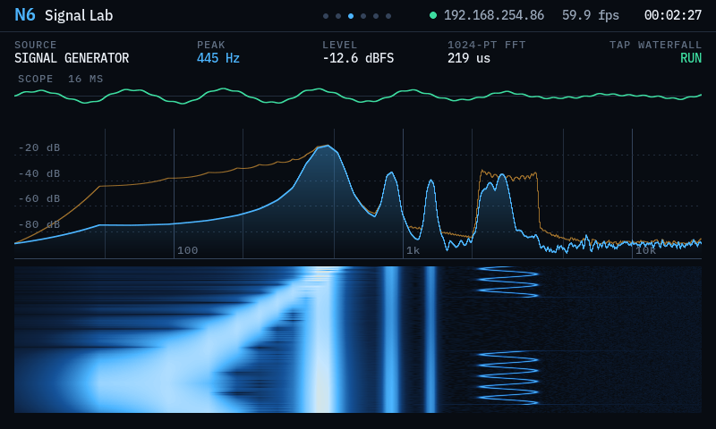
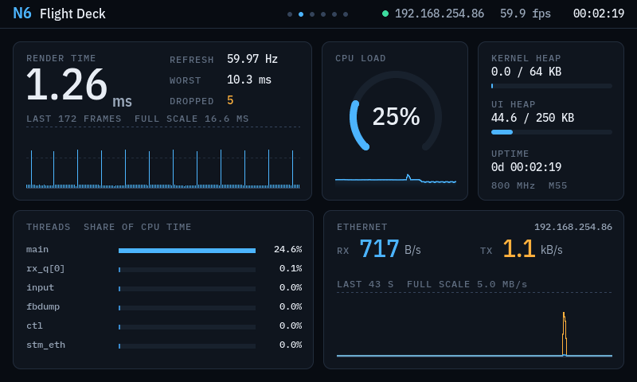

# stm32n6-demo

A multi-screen touch demo for the **STM32N6570-DK**: live dashboards, dense
real-time data visualization, and full-screen video with sound, built on
Zephyr 4.4.0 and LVGL 9.5. The audience is engineers and UX designers, so the
rules are: lock to the panel refresh, no fake data, and show the measurements.

> **Status: Phases 0 to 3 working on hardware; network features, video
> playback and audio are not built yet.** Six screens run at the panel's
> 59.98 Hz with no dropped frames in the automated tour. Touch has only been
> exercised with injected contacts, not yet by a person. See [Status](#status).

| | |
|---|---|
|  |  |
|  |  |

Screenshots are the board's own frame buffer, read back over Ethernet.
The plan, with architecture, budgets, phases and risks, is in
[`docs/plan.html`](docs/plan.html).

## Hardware

| Part | Detail |
|---|---|
| Board | STM32N6570-DK (MB1939), STM32N657X0, Cortex-M55 at 800 MHz with Helium |
| Display | 5 inch 800 x 480 RGB888 panel on LTDC, GT911 5-point capacitive touch |
| Memory | 4.2 MB internal SRAM, 32 MB HexaSPI PSRAM, 128 MB octal NOR (XSPI2) |
| Network | Gigabit Ethernet, RTL8211F PHY (RGMII) |
| Audio | WM8904 codec to the headphone jack, MEMS microphone on MDF |
| Probe | On-board ST-LINK V3EC, virtual COM port (COM17 on this host) |

## Prerequisites

- Windows 10/11, Python 3.10+, Git, CMake, Ninja
- Zephyr SDK 1.0.1 (`arm-zephyr-eabi`)
- STM32CubeProgrammer 2.18 or later (provides `STM32_Programmer_CLI`, the
  signing tool and the `MX66UW1G45G_STM32N6570-DK` external loader)
- ffmpeg (video asset pipeline, later phases)

## Setup

```powershell
git clone https://github.com/murr2k/stm32n6-demo.git
cd stm32n6-demo
python -m venv .venv
.\.venv\Scripts\python.exe -m pip install west pyserial pillow numpy
.\.venv\Scripts\west.exe init -l app
.\.venv\Scripts\west.exe update
.\.venv\Scripts\python.exe -m pip install -r zephyr\scripts\requirements-base.txt `
    -r bootloader\mcuboot\scripts\requirements.txt
```

The project root is the west workspace (manifest in `app/west.yml`, pinned to
Zephyr `v4.4.0`). `zephyr/`, `modules/` and `bootloader/` are fetched, not
committed.

## Build, flash, run

Leave the boot switches at **BOOT1 = H, BOOT0 = L** (development boot). The
whole loop then runs unattended:

```powershell
.\n6.cmd go                 # build + flash + power-cycle + start + console
.\n6.cmd go -p              # same, pristine build (needed after adding a .overlay or .conf file)
.\n6.cmd go --app-only      # skip reflashing MCUboot
.\n6.cmd run --secs 20      # restart what is in flash and watch the console
.\n6.cmd console            # just listen on the serial console
.\shot.cmd --host <ip>      # save the board's frame buffer to captures\shot.png
```

`n6.cmd` wraps `tools/n6.py`:

1. `build`: `west build --sysbuild -b stm32n6570_dk`, producing MCUboot (the
   first-stage boot loader, ST-signed) and the application (MCUboot-signed,
   executes in place from XSPI flash).
2. `flash`: power-cycles the target through the ST-LINK, then writes MCUboot
   to `0x7000_0000` and the app to slot 0 with ST's external loader over SWD.
3. `run`: power-cycles again, loads MCUboot into RAM over SWD and starts it.
   MCUboot validates slot 0 and jumps to the app.

For stand-alone use (no PC), set **BOOT1 = L** and power-cycle: the boot ROM
then loads MCUboot from flash by itself.

### Why the power cycles

ST's external loader leaves the NOR flash in octal DTR mode. A pin reset does
not undo that, and Zephyr's XSPI flash driver then stalls on its first
SPI-mode command (`XSPI reset enable (SPI/STR) failed`, MCUboot aborts). Only
removing power returns the flash to SPI mode. The ST-LINK V3EC can switch the
target supply, so `STM32_Programmer_CLI --power off/on` does it without a
finger on the board. The loader has the mirror-image problem: it only works
against the boot ROM's idle state, not against running firmware.

## Remote control and automated review

The firmware listens on two TCP ports (trusted LAN only, no authentication):

| Port | Purpose | Host tool |
|---|---|---|
| 5555 | One frame of the display, captured at a frame boundary | `tools/shot.py` |
| 5556 | Text commands: switch screen, frame statistics, inject touches | `tools/ctl.py` |

```powershell
.\.venv\Scripts\python.exe tools\ctl.py "screen 2" stats
.\.venv\Scripts\python.exe tools\ctl.py "swipe 600 250 200 250 180" "tap 400 200"
.\.venv\Scripts\python.exe tools\tour.py        # every screen: stats, screenshots, gestures
```

`tour.py` is the regression check: it visits each screen, measures frame time
and dropped frames over five seconds, saves screenshots to `captures/tour/`,
then drives Touch Lab and Explorer with injected multi-touch (three contacts,
a pinch, a flick, an edge swipe).

## Layout

```
app/                    Zephyr application (also the west manifest repo)
  boards/               devicetree overlay: memory map, 60 Hz timing, MAC
  src/platform/         display (gfx), touch, network, telemetry, PSRAM, remote control
  src/ui/               design tokens, fonts, shell, direct rasteriser
  src/dsp/              signal generator + FFT, Explorer dataset + pyramid
  src/media/            hardware JPEG decode
  src/screens/          one file per screen
assets/                 font sources (IBM Plex, OFL), poster image
tools/
  n6.py                 build / flash / run / console
  shot.py, ctl.py       screenshot and remote-control clients
  tour.py               automated review
  gen_fonts.py          TTF to LVGL bitmap fonts (needs npm install in tools/fontconv)
  make_poster.py        renders assets/media/poster.jpg
  gdbrun.ps1            scripted ST-LINK gdbserver + GDB session for bring-up
docs/plan.html          the plan
captures/               screenshots and logs pulled off the board (not committed)
```

## Screens

| Screen | What it shows | Frame time, avg / worst |
|---|---|---|
| Home | A tile per screen; each thumbnail is drawn live by that screen's code | 4.9 / 5.9 ms |
| Flight Deck | Frame time, CPU share per thread, heaps, Ethernet rates: the board measuring itself | 2.6 / 6.2 ms |
| Signal Lab | Triggered scope, log-frequency spectrum with peak hold and cursor, waterfall; one 1024-point Helium FFT per frame (about 220 us) | 7.5 / 9.4 ms |
| Explorer | 2^20 samples x 4 channels with a min/max pyramid in PSRAM; pan, pinch, cursor, auto tour | 2.8 / 12.8 ms |
| Touch Lab | Five contacts with trails, crosshairs, distance, report rate, touch-to-swap time | 1.5 / 2.1 ms |
| Cinema | One JPEG decoded by the hardware codec and converted by DMA2D (decode 20 ms, convert 9.5 ms, polling mode) | static |
| Specimen | Type scale, colour tokens, motion test | 1.8 / 2.7 ms |

Frame time is all UI-thread work for a frame (screen logic, layout, render),
measured on the board over five seconds per screen by `tools/tour.py`. The
budget at 59.98 Hz is 16.67 ms.

Signal Lab's source is a built-in signal generator and Explorer's dataset is
synthetic; both are labelled as such on screen. Everything on Flight Deck is
measured.

## Status

| Item | State |
|---|---|
| Unattended build, flash, run | Working, board left in development boot |
| Panel | 800 x 480 ARGB8888 at 59.98 Hz, double buffer in internal SRAM, swap in the line interrupt |
| Internal SRAM vs PSRAM (1.5 MB buffer) | fill 945 vs 466 MB/s, copy 361 vs 85 MB/s, read 691 vs 212 MB/s |
| Ethernet | 1000 Mb full duplex, DHCP |
| Hardware JPEG decode | Working: matches a software decode to within 0.5 levels per channel on average |
| Touch | Driver configured for 5 points; only injected contacts tested so far |
| Stand-alone boot (BOOT1 = L) | Not tested, needs a hand on the switch |
| Microphone as Signal Lab source | Not started (generator only) |
| Host companion, Host Link screen, web remote, OTA | Not started |
| Video player, audio out, original demo video | Not started (decode path proven) |
| Screen transitions, attract mode, soak test | Not started |
## License

Apache-2.0 for the sources in this repository, matching Zephyr.
