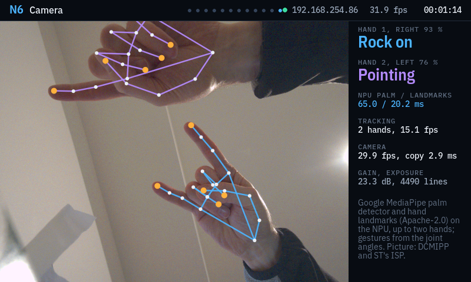
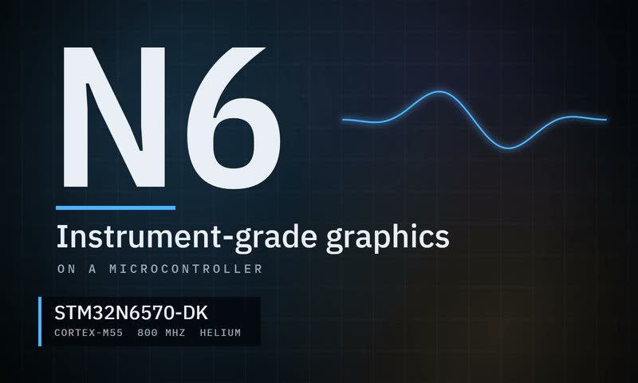
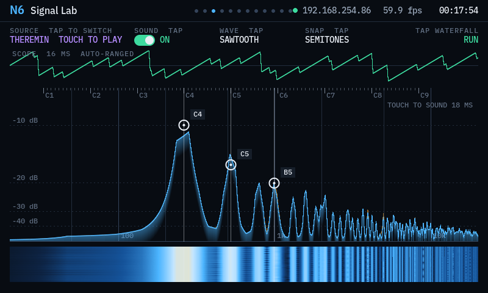
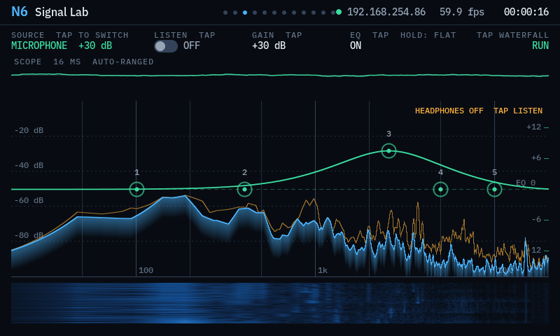

# stm32n6-demo

A multi-screen touch demo for the **STM32N6570-DK**: live dashboards, dense
real-time data visualization, full-screen video with sound, and a live camera
with hand tracking on the NPU, built on Zephyr 4.4.0 and LVGL 9.5. The
audience is engineers and UX designers, so the rules are: lock to the panel
refresh, no fake data, and show the measurements.

> **Status: twelve screens, video with sound, and camera hand tracking work on
> hardware** (the twelfth, Home Power, only while the board can reach the
> internet). Every screen holds the panel's 59.98 Hz with no dropped frames
> in the automated run. A 48 s original film plays at 30 fps with stereo sound
> from flash or from a microSD card, and clips upload to the card over
> Ethernet at 2 to 4 MB/s while the demo runs. The camera runs at 30 fps, and
> the NPU tracks up to two hands in it: 21 points each, the gesture, and
> which hand it is. Signal Lab's spectrum analyser doubles as a theremin
> you play with up to five fingers. Touch, motion, colour, sound and hand tracking have
> been checked by hand on the panel. Left alone for 90 seconds it tours
> itself. Signal Lab also plays the board's own microphone into the
> headphones, 8.7 ms late, through a five-band equalizer you shape with your
> fingers on the spectrum. And it records itself, screen and sound, with
> its own hardware H.264 encoder. See [Status](#status) and the
> [changelog](CHANGELOG.md).

**Video:** [one attract lap, recorded by the board itself](https://youtu.be/fsazWDnm2qg)
(4 min 36 s, 4K60).

| | |
|---|---|
|  |  |
|  |  |
|  |  |
|  |  |

Screenshots are the board's own frame buffer, read back over Ethernet.
The plan, with architecture, budgets, phases and risks, is in
[`docs/plan.html`](docs/plan.html). What we learned about the board, its
display and Zephyr, for developers starting their own project on it:
[`docs/best-practices.md`](docs/best-practices.md).

## Hardware

| Part | Detail |
|---|---|
| Board | STM32N6570-DK (MB1939), STM32N657X0, Cortex-M55 at 800 MHz with Helium |
| Display | 5 inch 800 x 480 RGB888 panel on LTDC, GT911 5-point capacitive touch |
| Memory | 4.2 MB internal SRAM, 32 MB HexaSPI PSRAM, 128 MB octal NOR (XSPI2) |
| Storage | microSD slot on SDMMC2, 4-bit; optional (a 32 GB FAT32 card here) |
| Network | Gigabit Ethernet, RTL8211F PHY (RGMII) |
| Audio | WM8904 codec to the headphone jack, MEMS microphone on MDF |
| Camera | B-CAMS-IMX module: Sony IMX335, 5 Mpx, on MIPI CSI-2, through the DCMIPP and ST's ISP |
| NPU | ST Neural-ART accelerator, running Google MediaPipe's hand networks (converted with ST Edge AI) |
| Probe | On-board ST-LINK V3EC, virtual COM port (COM18 on this host; `N6_PORT` sets another) |

## Prerequisites

- Windows 10/11, Python 3.10+, Git, CMake, Ninja
- Zephyr SDK 1.0.1 (`arm-zephyr-eabi`)
- STM32CubeProgrammer 2.18 or later (provides `STM32_Programmer_CLI`, the
  signing tool and the `MX66UW1G45G_STM32N6570-DK` external loader)
- ffmpeg (video asset pipeline)
- Optional, for hand tracking: ST Edge AI 4.0 (`C:\ST\STEdgeAI\4.0`, or set
  `STEDGEAI_CORE_DIR`). Without it the firmware builds with the NPU left out:
  the Camera screen shows the picture and says that the NPU is not in the build

## Setup

```powershell
git clone https://github.com/murr2k/stm32n6-demo.git
cd stm32n6-demo
python -m venv .venv
.\.venv\Scripts\python.exe -m pip install west pyserial pillow numpy av
.\.venv\Scripts\west.exe init -l app
.\.venv\Scripts\west.exe update
.\.venv\Scripts\python.exe -m pip install -r zephyr\scripts\requirements-base.txt `
    -r bootloader\mcuboot\scripts\requirements.txt
```

The project root is the west workspace (manifest in `app/west.yml`, pinned to
Zephyr `v4.4.0`). `zephyr/`, `modules/`, `bootloader/` and `zprof/` (the
tracer, part of the build: "Profiling with zprof" below) are fetched, not
committed. A workspace set up before zprof was part of the build may still
filter it out: `west config -d manifest.group-filter`, then `west update`.

## Build, flash, run

Leave the boot switches at **BOOT1 = H, BOOT0 = L** (development boot). The
whole loop then runs unattended:

```powershell
.\n6.cmd go                 # build + flash + power-cycle + start + console
.\n6.cmd go -p              # same, pristine build (needed after adding a .overlay or .conf file)
.\n6.cmd go --app-only      # skip reflashing MCUboot
.\n6.cmd run --secs 20      # restart what is in flash and watch the console
.\n6.cmd console            # just listen on the serial console
.\shot.cmd --host <ip>      # save the board's frame buffer to captures\shot.png
```

`n6.cmd` wraps `tools/n6.py`:

1. `build`: `west build --sysbuild -b stm32n6570_dk`, producing MCUboot (the
   first-stage boot loader, ST-signed) and the application (MCUboot-signed,
   executes in place from XSPI flash).
2. `flash`: power-cycles the target through the ST-LINK, then writes MCUboot
   to `0x7000_0000` and the app to slot 0 with ST's external loader over SWD.
3. `run`: power-cycles again, loads MCUboot into RAM over SWD and starts it.
   MCUboot validates slot 0 and jumps to the app.

For stand-alone use (no PC), set **BOOT1 = L** and power-cycle: the boot ROM
then loads MCUboot from flash by itself.

### Why the power cycles

ST's external loader leaves the NOR flash in octal DTR mode. A pin reset does
not undo that, and Zephyr's XSPI flash driver then stalls on its first
SPI-mode command (`XSPI reset enable (SPI/STR) failed`, MCUboot aborts). Only
removing power returns the flash to SPI mode. The ST-LINK V3EC can switch the
target supply, so `STM32_Programmer_CLI --power off/on` does it without a
finger on the board. The loader has the mirror-image problem: it only works
against the boot ROM's idle state, not against running firmware.

## Host Link and Core Map

```powershell
.\.venv\Scripts\python.exe -m pip install psutil    # once
.\run.cmd                                           # finds boards by itself; or: run.cmd --host <board ip>
```

`run.cmd` starts `host/companion.py`, which sends this PC's per-core CPU
load, memory use and network throughput to the board ten times a second and
times the board's reply to each datagram. On Windows it also sends the
CPU's layout (which logical processors are P-cores, E-cores, low-power
E-cores and SMT siblings), which the Core Map uses for its floor plan; on
other systems the Core Map falls back to a plain grid. Only those aggregate
numbers leave the PC: no process names, no host name. It opens no listening
port (replies return on the socket it sends from), so there is no firewall
prompt. Without the companion both screens say they are waiting; they do not
show placeholder data.

The companion finds boards by itself: it broadcasts a four-byte query on
udp/5557 and every board answers with one line naming itself and its
services; it then sends to all of them, and asks again every 10 s. Any host
can describe up to 255 logical processors. The board keeps 128; Host Link
shows all of them, and Core Map draws up to 64 posts, so a larger host is
shown a post per physical core (its SMT threads averaged) or per pair of
processors, and the header says so. `companion.py --cores N` sends a
synthetic load on N processors, for testing that, and is labelled as a test
option only.

## The board's address, and a description for people and agents

The Settings screen shows the board's address and MAC, and sets a fixed
address (address, mask, gateway on a keypad) or DHCP. The change takes effect
at once, without a restart, and is kept on the microSD card (`n6demo.cfg`);
with a fixed address the board is on the network about 1 s after power-up
instead of about 8. Holding the USER button while the board powers up
ignores the stored address and uses DHCP. `ctl.py "netcfg static IP MASK GW"`
and `ctl.py "netcfg dhcp"` do the same over the network.

On http/80 the board serves a remote for a phone at `/`: the screen on the
panel and a clip playing, a button for every screen and clip, Previous,
Home and Next, Run and Stop for the demo, and the frame rate, frame time
and dropped frames, live. The Settings screen shows a QR code for it. The
page is one file in the firmware (no fonts or scripts from elsewhere, so it
works on a network without the internet); there is no login, so it belongs
on a trusted network, and nothing on it deletes or reconfigures anything.
The remote outranks the test tour (`tools/tour.py`): it shows a tour running
and its step, anything picked on it stops the tour at once, and Start runs
one on the PC through the companion. While the remote is open, the demo does
not start by itself.
The board also describes itself: `/about` is a page, `/agent.md` the same
text as Markdown for an agent (what the board is, its screens, every network
service and protocol, how to find and drive it, and what not to do), and
`/status.json` its live state.

The companion can be left running across board restarts. The board announces
its address (a gratuitous ARP) when DHCP assigns it; without that, Windows
kept a host that had been sending into the void from finding the board again
for up to a minute. Measured with the companion sending through a power
cycle: the board answered 0.1 s after it had its address.

## Home Power, over the internet

When the board can reach a household energy monitor's web API, a Home Power
tile appears on Home, itself a live gauge of the power now, and opens the
panel: the power now on a notched gauge whose thin arc is the
last 24 hours' range, the 24-hour minimum, mean, peak and cost, a chart of
the last hour to the last 30 days (each bucket's mean, and a band from its
minimum to its maximum) with the range's own figures, and the bill so far
with its forecast. It is laid out and coloured like the monitor's own web
dashboard in its Notch skin. The screen says where the numbers come from and
how old the reading is, and greys out 2 minutes after the last one, as the
dashboard does. Without the monitor the tile, its page dot and its place in
the edge swipes go away by themselves, and come back when it answers.

The monitor's address is set on the board, not in this repository:
`ctl.py "power url http://HOST"` applies it at once and keeps it on the
microSD card (`power.cfg`); `ctl.py power` shows what the feed is doing. The
board looks the name up itself (from DHCP's DNS server, or the gateway with
a fixed address) and polls plain HTTP (there is no TLS on the board) on a
thread of its own: every minute, every 15 s while the screen or Home shows. The
chart's time axis counts back from "now", because the board keeps no clock
of the house's time zone.

## Remote control and automated review

The firmware listens on these ports (trusted LAN only, no authentication):

| Port | Purpose | Host tool |
|---|---|---|
| tcp/5555 | One frame of the display, captured at a frame boundary | `tools/shot.py` |
| tcp/5556 | Text commands: switch screen, start attract mode, which screen is up (`where`), frame statistics, inject touches, audio, video and clip-list status, open a clip, NPU and hand tracker (`nn`) | `tools/ctl.py`, `tools/nn.py` |
| udp/5557 | Host telemetry in, echo out; `N6HQ` discovery query answered with `N6HA` | `host/companion.py` |
| tcp/5558 | Clips to and from the list on the microSD card: put (with CRC-32), list, delete, free space | `tools/n6v.py upload`, `ls`, `rm`, `df` |
| tcp/80 | The web remote at `/` (state `/remote.json`, actions `POST /screen/N`, `/play/N`, `/demo/start`, `/demo/stop` with the header `X-N6: 1`); the board describes itself: `/about`, `/agent.md`, `/status.json` | a phone or a browser, `curl`, an agent |
| tcp/5560 | zprof's trace stream, one client (below) | zprof's bridge |

```powershell
.\.venv\Scripts\python.exe tools\ctl.py "screen 2" stats
.\.venv\Scripts\python.exe tools\ctl.py "swipe 600 250 200 250 180" "tap 400 200"
.\.venv\Scripts\python.exe tools\tour.py        # every screen: stats, screenshots, gestures
```

`tour.py` is the regression check: it starts the companion, visits each
screen, measures frame time and dropped frames over five seconds, saves
screenshots to `captures/tour/`, pans Home with five placeholder tiles added
(rest position, a tap on a tile that has moved, an edge swipe), then drives
Touch Lab, Explorer and Core Map
with injected multi-touch (three contacts, pinches, a flick, an orbit, an
edge swipe), plays the theremin (a glide, a chord, lifts: the sound recorded
and checked for steps, a held touch's pitch and level against its column
and height, a finger off the spectrum, the SOUND switch), checks that 80 touch releases never change the screen, enters
every screen through a transition (26 changes, six of them from a playing
film into Explorer), plays the film from flash and from the card, opens and
closes a clip three times, records what the DAC gets during a drag on the
slider, a pause and a resume and counts the discontinuities in it, uploads a
generated test clip to the card while
Signal Lab runs, plays it, seeks in it five times, scrolls the gallery,
deletes it again, and runs one lap of attract mode. About seven minutes; a
screenshot costs the UI one frame (an 18 ms copy to PSRAM), so none is taken
inside a measured window.

`fuzz_player.py` is the abuse test for the player: random scrubs with a
wandering finger, some starting at a screen edge, some with a second
contact, mixed with play, pause, back and re-open. It names every action
that costs the UI a frame or stalls playback, and a seed replays a run.

`acap.py` records up to three seconds of what the firmware hands to the DAC
(a copy into PSRAM, read back over the control port) as a WAV file, and with
`--clicks` counts the steps in it that do not belong to the signal. It is how
the sound of the slider is checked without ears.

The control port serves one client at a time and drops one that has been
silent for five seconds. `ctl.py` keeps a single connection open for a
whole script; a tool that opens a connection per command will exhaust the
board's sixteen TCP slots and find it unreachable for a while.

## Profiling with zprof

[zprof](https://github.com/murr2k/zprof) traces the demo over its Ethernet
port while it runs and shows it in the browser: every thread switch and
interrupt, kernel objects, each frame and audio refill, and the demo's own
counters every 100 ms. No debug probe, and the core never halts. It is part
of every build: `west update` fetches it into `zprof/` (ignored here) at the
tag `app/west.yml` pins, and `app/CMakeLists.txt` builds its module with the
demo's settings (`app/zprof.conf`). So any board running the demo can be
traced; on the PC:

```powershell
cd zprof; python -m venv .venv; .venv\Scripts\pip install -r host\bridge\requirements.txt
cd host\bridge
..\..\.venv\Scripts\python -m zprof_bridge serve --host <board> --elf ..\..\..\build\app\zephyr\zephyr.elf `
    --irq-header ..\..\..\modules\hal\stm32\stm32cube\stm32n6xx\soc\stm32n657xx.h `
    --deadlines ..\..\integrations\stm32n6-demo\deadlines.json
```

The ELF must be the one of the build on the board (the bridge checks a build
id). `n6.cmd build --no-zprof` leaves zprof out (build dir `build-nozprof`):
for the SystemView build, and to measure what zprof costs;
`--zprof DIR` builds it from another checkout.

The dashboard (zprof's README: Sferic checked out beside zprof as
`lightning/`, also ignored here, then `npm ci` and `run.cmd` in zprof) is
then at http://127.0.0.1:8781/#target, with the Schedulability (`#sched`)
and Timing (`#ltiming`) views beside it.

What it costs: tcp/5560 (one client) and `prof=5560` in the discovery answer,
about 10 KB of code, 7 KB of internal RAM (its 64 KB ring is in the M55's
DTCM, which the overlay declares), and 4 MB of PSRAM taken at the first
capture-then-upload. With nobody
connected its hooks return at once; Home's frames take about 0.2 ms more than
without zprof (Zephyr's tracing hooks), about 0.3 ms more while a bridge
streams. Full `tour.py` either way: 0 dropped frames, 0 audio underruns. The
demo's side is `app/src/platform/prof.c` (the capture buffer, and
`gfx_stats()` and the audio counters as heartbeat gauges) and the marks in
`gfx.c` (each frame as a job, each frame's margin as a plot); `prof.h` makes
them empty in a build without zprof.

A missed frame also calls `ZPROF_TRIGGER(1)` (`gfx.c`), for zprof's flight
recorder: armed (`zprof_bridge recorder arm --host <board>`), the board keeps
recording into the ring while nobody is connected, and the first missed frame
freezes it 20 ms later. The next `zprof_bridge recorder status -o x.zpr --elf
...` saves what led up to it (0.4 s of Home in the 64 KB ring) for `summary`
and the other commands. It is how a drop that comes once an hour is caught
with nobody watching. It is off after a reset, and a reset loses what it held.

## Layout

```
app/                    Zephyr application (also the west manifest repo)
  boards/               devicetree overlay: memory map, 60 Hz timing, MAC
  src/platform/         display (gfx), touch, network, telemetry, PSRAM, remote control
  src/ui/               design tokens, fonts, shell, direct rasteriser
  src/dsp/              signal generator + FFT, Explorer dataset + pyramid
  src/media/            hardware JPEG decode, clip player, microSD card and upload service, camera
  src/nn/               NPU runtime glue, hand tracker
  src/screens/          one file per screen
assets/                 font sources (IBM Plex, OFL)
media/film/             the original film, companion clips and soundtrack, as code
host/companion.py       PC telemetry sender for the Host Link screen (run.cmd)
tools/
  n6.py                 build / flash / run / console
  shot.py, ctl.py       screenshot and remote-control clients
  tour.py               automated review
  fuzz_player.py        random abuse of the video player through injected touches
  acap.py               record the DAC feed or the microphone as a WAV file, count discontinuities
  dataset.py            move Explorer's data set from PSRAM into the flash
  gen_fonts.py          TTF to LVGL bitmap fonts (needs npm install in tools/fontconv)
  n6v.py                encode video clips; upload them to the card, or pack and flash them
  record.py             the board records its own screen and sound (hardware H.264): MKV and MP4
  avsync.py             the A/V sync clip recorded by the board: each flash against its beep
  nn.py                 NPU networks: fetch, convert, flash, check against the PC; watch and grab the tracker
  gdbrun.ps1            scripted ST-LINK gdbserver + GDB session for bring-up
docs/plan.html          the plan
docs/best-practices.md  the STM32N6570-DK with Zephyr: what we had to figure out
docs/microphone.md      the onboard microphone: findings and sources
captures/               screenshots and logs pulled off the board (not committed)
```

## Screens

| Screen | What it shows | Frame time, avg / worst |
|---|---|---|
| Home | A tile per screen; each thumbnail is drawn live by that screen's code. Two rows of four; more screens go into further columns that pan in under the finger and come to rest on a column | 5.4 / 6.4 ms |
| Flight Deck | Frame time, CPU share per thread, heaps, Ethernet rates: the board measuring itself | 2.9 / 7.9 ms |
| Signal Lab | Triggered scope, log-frequency spectrum with peak hold and cursor, waterfall; one 1024-point Helium FFT per frame (about 220 us). Three sources: a signal generator, the microphone (to the headphones through a finger-operated parametric equalizer, see [Listening to the microphone](#listening-to-the-microphone)), and a theremin played on the spectrum itself (see [The theremin](#the-theremin)) | 5.0 / 6.5 ms; playing, up to 8.5 ms |
| Explorer | 2^20 samples x 4 channels with a min/max pyramid, used in place from the flash; pan, pinch, cursor, auto tour | 11.1 / 14.5 ms while it zooms, 3 ms at rest |
| Touch Lab | Five contacts with trails, crosshairs, distance, report rate, touch-to-swap time | 1.7 / 2.4 ms |
| Host Link | A PC's per-core CPU load as a scrolling heat map, memory, network throughput and datagram round-trip time, pushed over UDP by `run.cmd` | 6.7 / 10.0 ms |
| Core Map | The same PC's logical processors as posts on a floor plan of its chip (P-cores, E-cores, SMT threads), height and colour by load. Drag to orbit, pinch to zoom and pan, tap a post, double tap to reset. Software 3D: projected in floating point, filled as anti-aliased quads, no depth buffer | 6.8 / 7.7 ms; 12 ms with every post at 100 % |
| Cinema | Clips from flash and from the microSD card in a gallery that scrolls sideways; full screen with overlay controls, scrubbing (the picture follows the finger, the sound is cross-faded 85 ms pieces of the clip) and a stats panel (decode and conversion time, bit rate, seek time, read-ahead). Hardware JPEG decode about 10 ms a frame, DMA2D conversion 4.8 ms, video slaved to the audio clock | 30 fps video, no drops; a video frame costs the UI 6.2 ms, 9.2 ms with the controls up, 9.9 ms while scrubbing |
| Specimen | Type scale, colour tokens, motion test | 1.9 / 3.1 ms |
| Settings | The board's address (DHCP or fixed, entered on a keypad, applied at once, kept on the card), a QR code for the board's own description at http://<board>/, and which PC is feeding Host Link and Core Map | 1.8 / 2.0 ms |
| Camera | The IMX335 (B-CAMS-IMX module, 5 Mpx) live at 30 fps: demosaiced and scaled to 592 x 444 by the DCMIPP, auto exposure and white balance by ST's ISP middleware, copied to the display by DMA2D (3 ms). Over it, hand tracking on the NPU, up to two hands (see [Hand tracking on the NPU](#hand-tracking-on-the-npu)): each hand's 21 points and their bones are drawn on the picture in its own colour, its gesture is read from the joint angles (fist, open hand, pointing, victory, three, four, thumbs up and down, thumb out, OK, rock on, call me, I love you in American Sign Language, the bird, or a finger count), and the side panel names each hand (left or right, and how sure the network is). Beside it the NPU's time per network, how many hands and at what rate, and what the ISP chose. The camera and the NPU run only while the screen is up | 5.0 / 8.7 ms |
| Home Power | A household's electricity from its energy monitor over the internet (see [Home Power, over the internet](#home-power-over-the-internet)): the power now on a gauge with the last 24 hours' range, the 24-hour figures, a chart of 1 hour to 30 days with each bucket's mean and its minimum-to-maximum band, the bill so far and its forecast. Listed on Home and in the swipes only while the monitor answers | 1.1 / 1.2 ms (it redraws when figures arrive); its first frame about 10 ms |

Frame time is all UI-thread work for a frame (screen logic, layout, render),
measured on the board over five seconds per screen by `tools/tour.py`. The
budget at 59.98 Hz is 16.67 ms. Host Link and Core Map are measured with the
companion running. The same run makes 27 screen changes and a 150 s lap of
attract mode: no dropped frame in either, worst frame 14.8 ms.

Explorer is the screen closest to the budget, and it was over it until the
build was told about the FPU: the N657's Cortex-M55 has double precision, but
Zephyr 4.4.0 builds for single precision, so every `double` in the per-column
position maths was a library call (2 to 5 ms a frame). `app/Kconfig` selects
the double-precision FPU; the sample markers also stopped taking a square
root per pixel.

Signal Lab's default source is a built-in signal generator (its other one is
the microphone) and Explorer's dataset is synthetic; the screen says which
source is on, and labels both as what they are. Everything on Flight Deck is
measured.

Explorer's 14 MB (the samples and their pyramid) used to be generated into
PSRAM at every start, which made it the largest holder of the 32 MB by far.
It is read-only, so it now lies in the last 16 MB of the flash and is used
where it lies: PSRAM in use went from 25.3 to 11.6 MB and the 1.5 s of
generating became a 0.44 s checksum. Reading it from the flash costs nothing
that shows: the worst frame is 14.1 ms in the zoom tour (13.8 ms from PSRAM)
and 12.3 ms under gestures (12.0 ms). A board without the copy generates the
data into PSRAM as before, and that is also where the copy comes from:

```powershell
.\.venv\Scripts\python.exe tools\dataset.py pull -o media\out\dataset.bin   # read it out of the running board, checksum verified (1 min)
.\.venv\Scripts\python.exe tools\dataset.py flash media\out\dataset.bin     # write it to the flash over SWD (1.5 min), then n6.cmd run
.\.venv\Scripts\python.exe tools\dataset.py info                            # flash or generated, checksum
```
### Navigation, transitions, attract mode

Swipe in from the left or right edge to step between screens, tap a Home tile
to jump, tap the wordmark and title at the left of the bar to go back. The
USER button toggles a frame-time overlay.

A screen change is a 110 ms fade out, the swap, then a 200 ms fade in while
the picture settles upwards by 10 px. Neither is rendered: the fade is the
LTDC layer's constant alpha and the settle its window position, both
reloaded at the vertical blank, over a background colour that matches the
theme. The frame that builds the new screen is therefore drawn while the
display is dark, and a transition costs no frame time. Blending a veil in
software dropped a frame on every transition; moving the screen's objects
for the settle made LVGL redraw all of them on every frame of the fade-in
(9 to 13 ms on Flight Deck), and the 9-hour soak test caught that dropping
a frame there. The swap itself (one screen's hide, the next one's show)
runs just after a frame has been presented, so its time comes out of the
budget of the frame that builds the new screen; `ctl.py stats` reports it
as `tail_worst_us`, and `ctl.py swtrace` shows where every frame of the
last transition spent its time. A screen's first frame after leaving a
playing film (Under the Hood's, a screen since removed) missed a refresh
that way about once in three attract laps, unseen in the dark but counted;
the tour now makes the film to Explorer switch six times.

Frames are swapped by the application, not by Zephyr's display driver. The
driver cleans the data cache line by line over the whole 1.5 MB buffer
before every swap (0.54 ms, nearly all of it a loop over lines that are
already clean) and swaps at line 0, the middle of the vertical blanking. A
clean of the whole cache takes 25 µs, and a frame finished during the
blanking still makes the next refresh: about 1 ms more for every frame on
every screen.

After 90 seconds without a touch the demo runs itself, in a lap of 2 min 28 s
set to music. It opens with the film, *N6: the film*, and cuts at 0:43 to the
demos, each arriving on a bar line of the film's music, which plays on under
all of them: Home, Flight Deck, Signal Lab (a ghost flies a 1950s saucer on
the theremin, quietly, over a break in the music), four bars of the Camera
screen tracking two hands and naming their gestures (a recording the board
made of itself, marked as one: the lap never turns the camera on), Explorer
zooming, Host Link and Core Map. Then the film's last scene comes back
with its musical coda, end titles follow (who made it, and how: the demos run
live on the board; the film and its score are code, every frame drawn and
every note synthesized by a script, no samples or stock art), and after two
seconds of black the lap starts again. The title bar says so
while it does, and any touch hands control back (and stops the music).
`ctl.py attract` starts it immediately; `ctl.py where` reports where in
the lap it is (`lap_ms`).

The music and the film's two parts are one clip on the microSD card,
`/SD:/clips/_attract.n6v` (a leading underscore keeps a file out of
Cinema's list). `media/film/attract.py` makes it from the film's master:
the film's score at lap length (the film's own music, sample for sample, to
0:43.2; then its groove carried on with a whoosh at every screen change,
pad and bass only under the theremin; then the coda on the film's last
two bars), the film's pictures to 0:43.2, black while the demos show
except for the four bars of recorded hand tracking (`tools/record.py
--camera`, 288 pictures; camera footage, so it is not in the repository),
and the film's last 4.8 s. Cinema plays it, and when the lap moves on it keeps
playing it, sound only; the shell changes screens by the clip's own clock,
the sample at the DAC, starting each fade 110 ms early so the new screen
arrives on the beat. Measured in the board's own recording of a lap: the
sound sent to the DAC is the clip's, sample for sample, through every
screen change, and each screen's first picture lands 2 to 39 ms after its
bar line (the recorded hand tracking within a frame of its sound). The theremin plays over the music instead of replacing it (an
overlay mix in the audio output), 8 dB down (`ctl.py "thmunder -80"`, dB x
10). The demos' bars are listed twice, in `attract.py` and in `main.c`; the
firmware checks the clip's length and, without the clip (no card) or with
one of another length, steps through the screens as before.

```powershell
.\.venv\Scripts\python.exe media\film\attract.py            # the lap's clip (needs the film's master, n6_film.py)
.\.venv\Scripts\python.exe tools\n6v.py upload media\out\_attract.n6v
```

## The theremin



Signal Lab's third source turns the spectrum analyser into an instrument. A
fingertip on the spectrum sounds the frequency of the column under it, on the
analyser's own log axis, at the level of the height it is at, so the peak
sits under the finger and follows it. The level axis is a loudness taper:
equal steps of height are equal steps of loudness (it doubles every 10 dB),
-6 dBFS at the top, -16 at half height, -26 at a quarter, silence at the
floor, and the spectrum's level axis uses the same scale while it is an
instrument. A finger plays from where it comes down on the spectrum until it
lifts: slid off the top or the bottom it keeps its level, slid past either
end its pitch stops there. Up to five fingers play five voices. WAVE picks
the timbre (sine; theremin, a sine with a little overdrive and vibrato;
triangle; band-limited sawtooth), each with its own picture on the log
spectrum, and the level a finger sets is the level of the fundamental under
it. SNAP pulls the pitch to semitones and marks them on the axis. SOUND
switches the output off: the instrument still plays on screen, and the DAC
gets silence (for a quiet attract mode). The scope above shows the waveform,
the waterfall strip below the melody.

- The synthesizer (`app/src/dsp/theremin.c`) is the audio output's source
  while it plays. It reads the touch panel itself at the start of every
  128-frame audio block (2.7 ms), from the audio thread.
  - **Touch to sound is about 4 to 5 ms** (3.8 ms, worst 4.8 in the tour),
    measured from the panel's report to the first sample at the DAC, and
    shown on screen.
  - It was 11 to 21 ms with 512-frame blocks.
- The sound never steps: pitch glides in log frequency, levels ramp, a lift
  decays over about 0.4 s, and a soft limiter keeps five loud fingers below
  -0.9 dBFS. In the tour's recordings of a glide, a chord and lifts:
  0 discontinuities.
- The DAC's clock is 47.7 kHz, not 48 (measured). The oscillators and the
  analysis both use the measured rate, so a touch at the 734 Hz column plays
  734 Hz in the air and on the axis.
- Five voices take 0.1 to 0.23 ms of synthesis per 2.7 ms block. Drawing
  the instrument, with its crosshairs and readouts, costs at most 8.5 ms a
  frame.
- In attract mode a ghost plays it: a 1950s flying saucer, two voices on
  keyframes with a wide, slow vibrato. Any touch takes over. With SOUND off
  the saucer flies in silence.

```powershell
.\.venv\Scripts\python.exe tools\ctl.py "screen 2" "sigsrc 2"     # Signal Lab with the theremin
.\.venv\Scripts\python.exe tools\ctl.py "thm 0 440 -12" "thm"     # a voice without touching, and the state
.\.venv\Scripts\python.exe tools\ctl.py "thmwave 3" "thmsnap 1" "thmghost 1" "thmsound 0"
```

## Listening to the microphone



With MICROPHONE as Signal Lab's source, the board's microphone goes to the
headphones through a five-band parametric equalizer, so you can judge it by
ear. The header's controls become:
- **LISTEN** switches the headphones on. It is off whenever the screen
  shows.
- **GAIN** steps +20, +30 and +40 dB.
- **EQ** puts the equalizer in or takes it out, for comparison. Holding EQ
  flattens every band.

The spectrum shows what the headphones get, with the equalizer's curve drawn
over it. Each band has a handle: a low shelf, three peaks and a high shelf.
- A finger on a handle drags it: across for frequency, up and down for gain
  (±15 dB, with a detent at 0).
- A second finger beside a held handle sets that band's width by its
  distance from the first.

How it works:
- **Microphone to headphones takes 8.7 ms**, from the digital side. The
  microphone and the DAC run from one clock, so the monitor reads the
  microphone a fixed 160 samples behind its newest sample, and both stream
  in 128-frame blocks (2.7 ms). With the earlier 512-frame blocks it was
  35 ms. The converters' own filters add to the 8.7 ms; that part is not
  measured.
- **The bands don't click when dragged.** They are state-variable filters
  (Andrew Simper's, in float) with the Audio EQ Cookbook's responses, and
  their settings are eased every 32 samples. They take about 75 µs of each
  2.7 ms block.
- **A limiter at −6 dBFS** keeps a clap or a knock at the board from hurting.
- **Checked in closed loop.** With headphones lying by the board, the board
  plays a tone into them instead of the microphone, then measures that tone
  in the microphone before and after the equalizer. In ten cases (peaks,
  shelves, widths, bypass) the measured gain agreed with the drawn curve
  within 0.2 dB.

```powershell
.\.venv\Scripts\python.exe tools\ctl.py "screen 2" "sigsrc 1" mon      # Signal Lab on the microphone, the monitor's state
.\.venv\Scripts\python.exe tools\ctl.py "monband 2 1000 60 140" "monlisten 1"   # PEAK 3 at 1 kHz, +6 dB, Q 1.4; headphones on
.\.venv\Scripts\python.exe tools\ctl.py "monlisten 0" "montone 1000 -200" mon  # closed loop: a -20 dBFS tone out, measured in the microphone
```

## Video and audio

Clips are Motion JPEG with 48 kHz stereo PCM in a small container (`.n6v`,
described in `app/src/media/player.h`). They live in two places: a media
partition of the XSPI flash at `0x7042_0000` (108 MB, up to Explorer's data
set at `0x7700_0000`), and `/clips` on a microSD card.

```powershell
.\.venv\Scripts\python.exe -m pip install skia-python     # once, for the film renderer
.\.venv\Scripts\python.exe media\film\n6_film.py          # render the 48 s film + soundtrack (about 12 minutes)
.\.venv\Scripts\python.exe media\film\n6_film.py --score-only   # new soundtrack, same picture (seconds)
.\.venv\Scripts\python.exe media\film\extras.py           # "Flow" and the A/V sync check
.\.venv\Scripts\python.exe tools\n6v.py encode any.mp4 -o media\out\clip.n6v --title "My clip" [--audio sound.wav]
# to the card, over Ethernet, while the demo runs: 84 MB in 22 s
.\.venv\Scripts\python.exe tools\n6v.py upload media\out\n6_film.n6v media\out\flow.n6v media\out\sync.n6v
.\.venv\Scripts\python.exe tools\n6v.py ls                # also: rm NAME.n6v, df
# or into the flash, over SWD, with the board stopped: about 8 minutes for 84 MB
.\.venv\Scripts\python.exe tools\n6v.py pack media\out\n6_film.n6v media\out\flow.n6v media\out\sync.n6v -o media\out\media.bin
.\.venv\Scripts\python.exe tools\n6v.py flash media\out\media.bin
```

The three clips are original: motion graphics drawn with Skia in the demo's
own design language and a soundtrack synthesised with numpy
(`media/film/`). `n6v.py encode` accepts anything ffmpeg can read. The
original clips take their sound from the rendered WAV (`--audio`), so the PCM
in flash is bit-identical to what the score produced; the MP4 masters carry
AAC and are only for viewing on a PC.

How playback works:

- A player thread feeds each JPEG to the hardware codec at register level and
  collects YCbCr MCU blocks (about 10 ms for 800 x 480).
- The Cinema screen's draw handler has DMA2D convert the newest frame straight
  into the LVGL frame buffer (4.8 ms); LVGL then draws the controls over it.
  The view tells LVGL that it covers the screen, which saves the background
  fill LVGL would otherwise do under every video frame (0.9 ms).
- Audio goes to the WM8904 codec over SAI1 with one circular DMA transfer that
  never stops. The DAC's sample clock is the master: the video frame shown is
  whichever one matches the sample now leaving the DAC.

### Clips on the microSD card


A clip in flash is read in place. A clip on the card (FAT32 or exFAT; the
firmware never formats) is streamed: a reader thread keeps a 4 MB window of
the file in PSRAM around the play position, the player thread and the audio
thread copy out of it, and where their data has not arrived they wait. The
clock is held and the sound goes quiet; nothing is skipped and no wrong
picture is shown, so a slow card would show as a pause and be counted
(`STALLS` in the stats panel). A card clip with the same title as a flash
clip takes its place in the gallery, and each card says which it is.

Measured by `tour.py` and `fuzz_player.py` on this board and card:

| | |
|---|---|
| Upload over Ethernet, CRC-32 verified | 2 to 4 MB/s (the film's 48.7 MB in 12 s); the card itself takes 9 to 12 MB/s |
| UI frames dropped during an upload and the gallery update after it | 0, with Signal Lab running |
| Playback from the card, 6.6 and 14 Mbit/s clips | 30 fps, 0 dropped, 0 stalls, 0 audio underruns |
| Read-ahead in steady state | 3.3 to 3.4 MB (3.4 s of the film, 1.7 s of the 14 Mbit/s clip) |
| Open to first picture | 31 to 39 ms from the card, 23 ms from flash |
| Seek to picture (a tap on the slider) | 11 to 47 ms from the card: about 12 ms when the target is already in the window, 32 to 47 ms when the card has to be read. 9 to 28 ms from flash |
| Player fuzz, 436 random actions on card clips | no fault, 0 UI frames dropped, 0 stalls |
| Discontinuities in the sound, recorded from the DAC feed | 0 in a slow drag, a fast drag, a held finger, three taps, pause and resume. Before the cross-fades: 35 a second in a slow drag, 50 in a fast one, 13 under a resting finger, one at every pause |

Three things were not what they seemed on the way:

- **The upload ran at 0.11 MB/s at first, and the card was not the reason**
  (it was writing at 12 MB/s). Zephyr's TCP acknowledges a segment at once
  only if it carries PSH, and otherwise after 100 ms; a host sets PSH when
  its send buffer runs empty, which a bulk send never lets happen. So the
  board advanced one 21 KB receive window per 100 ms. The protocol now sends
  8 KB pieces and waits for one byte from the board after each, which ends
  every piece in a PSH: 35 times faster.
- **The SDMMC's internal DMA needs security attributes of its own.** On the
  N6 a peripheral that masters the bus is non-secure until told otherwise,
  and Zephyr's SoC code tells the display, camera and Ethernet but not the
  SDMMC. Without them the mount fails (`fs mount error (-19)`); with
  interrupt-driven transfers instead, every 32 bytes would cost an interrupt.
- **Thumbnails must not be made on the UI thread.** The first version read
  the new clip list and decoded its pictures there after an upload: a 167 ms
  freeze. A background thread now does both, filtering each picture straight
  from the codec's YCbCr blocks, and the UI thread only swaps the list in.

Getting clean audio took three separate fixes, each recorded in `CLAUDE.md`:
the SAI and DMA clocks have to be enabled for sleep mode as well as run mode;
the codec has to be told it is the clock target; and the DMA's buffer has to
live in AHBSRAM1, because CPU write bursts into AXI RAM starve the DMA long
enough to underrun the 83 us SAI FIFO.

A fourth fault was not in the playback at all. Clicks at fixed places in the
film (6.24 s, 9.6 s and every four bars after) were in the soundtrack: the
score ended bass notes wherever they happened to be in their cycle, a step of
up to 7 % of full scale. Every voice now ends in a release ramp
(`media/film/score.py`). The check that settled it is worth repeating before
blaming hardware: extract the PCM from the `.n6v`, compare it with the WAV,
and look for isolated steps in both.

## The board records itself

The N6 has a hardware H.264 encoder, and the demo uses it to record its own
screen together with the sound it sends to the headphones. That's for a
video of the demo made by the demo, with no screen recorder or camera rig
(plan: [`docs/plan.html`](docs/plan.html), V1 to V5). The result is
[on YouTube](https://youtu.be/fsazWDnm2qg): one lap recorded at 60 fps, set
in a 4K frame by `media/film/video.py` with captions, cards and the board's
own frame-time strip.

- **The picture:** at the start of every second panel refresh, the encoder
  reads the frame buffer that's on screen, straight from the SRAM in its
  32-bit form. The CPU makes no copy and no colour conversion.
  - It takes about 7 ms a picture; 60 fps fits as well.
  - The display never draws into a buffer the encoder is still reading.
  - While recording, the tour shows 0 dropped frames and 0 audio underruns.
- **The sound:** every block handed to the DAC is streamed with the
  pictures. Each picture carries the DAC frame that was playing as it
  appeared, so the PC puts the picture on the sound's clock. The PC also
  measures the DAC's real rate (47.7 kHz) from the board's own clock.
- **Proof that they line up:** `tools/avsync.py` records the A/V sync clip
  and finds each flash and each beep, measured in DAC frames. The first run
  showed the player itself putting its pictures 33 ms behind their sound.
  The player now decodes 30 ms ahead, and flash and beep land within one
  refresh of each other (−8 to +13 ms).
- **The cache:** ST's encoder library writes the stream's headers with the
  CPU and the picture data with the hardware, into the same buffer. The data
  cache is written back at the moment the library starts the hardware,
  through a link-time wrap of the Zephyr driver's `EWLEnableHW()`. Cleaned
  any earlier, or invalidated afterwards, the stream lost its headers.
- **A driver bug, worked around:** Zephyr's VENC driver keeps a table of
  32 allocations that it never shrinks. After a few encoder starts it
  overflows and corrupts the memory pool; here the board faulted after 3 or
  4 restarts. The recorder routes the library's allocations past that
  table, also at link time.
- **The Camera screen only when asked for** (`--camera`): it is camera
  footage, so keep faces out of the picture. While that screen shows, the
  display is single-buffered (the NPU has the other buffer), and the encoder
  reading the buffer being drawn made the display wait. So the display
  copies each finished frame into PSRAM with DMA2D, in the time it would
  otherwise wait for the next refresh, and the encoder reads the copy.
  Measured with two hands tracked: 900 pictures in 30 s, none missed, the
  copy 3.0 ms, 0 dropped frames. With no hand in view the palm detector
  runs on every frame and its PSRAM traffic makes the encoder time out
  about twice a second (each one costs a few pictures). Without `--camera`
  the recorder skips that screen, and a recording holds the picture from
  just before it.
- **Recordings are hard cuts where the panel fades.** The fade and the
  settle between screens are done by the display controller on the way to
  the panel; the frame buffer, which the encoder reads, never fades. A
  video made from a recording adds them back at the screen changes.

```powershell
.\.venv\Scripts\python.exe tools\record.py --secs 20              # 20 s: captures\rec\<name>.mkv (PCM) and .mp4 (AAC)
.\.venv\Scripts\python.exe tools\record.py --attract --fps 60      # exactly one attract lap (its length from the board) at 60 fps
.\.venv\Scripts\python.exe tools\record.py --camera --secs 60      # the Camera screen too: camera footage, no faces
.\.venv\Scripts\python.exe tools\avsync.py                         # flash against beep, in DAC frames
.\.venv\Scripts\python.exe media\film\video.py --render            # the video from a lap recording: media\out\n6_video_4k60.mp4
```

## Hand tracking on the NPU


The Camera screen runs Google MediaPipe's hand pipeline (Apache-2.0 models)
on the N6's NPU, for up to two hands:

1. The **palm detector** (192 x 192 input) looks at the whole picture,
   letterboxed, and finds palms at any rotation: about 65 ms a run.
2. Around each palm, a square crop turned so that the fingers point up goes
   to the **hand landmark network** (224 x 224 input): 21 points in 3D,
   whether it is a hand, and which hand. About 22 ms.
3. From then on each frame's crop follows the previous frame's landmarks.
   With no hand in view the palm detector runs on every frame; with one hand
   tracked it looks for a second every 0.5 s. The points are smoothed with a
   one-euro filter, and the gesture, read from the joint angles, has to hold
   for three frames before it shows.

The hard part of two hands is not seeing the same hand twice. The palm
detector keeps finding the hand that is already tracked, and a half-closed
hand can pass for two: once whole, and once as a fist made of its own curled
fingers. A palm counts as a new hand only if its centre is well away from
every tracked palm (0.6 palm lengths) and its crop overlaps no tracked
hand's by half. After the landmarks, two tracks whose crops overlap by half,
or most of whose points lie on the other hand, are one hand, and the newer
goes. With crops alone, a minute of two hands held up had both tracked for
1 s; with these checks, for 53 s, and a hand opening and closing for 15 s
was never counted as two.

Measured on the board: one hand tracks at 26 to 30 fps (33 ms a frame: the
crop costs the CPU about 9 ms, reading the camera frame from PSRAM, and the
landmarks 22 ms); two hands at 15 fps, because the networks' inputs share
one place in memory and the hands run one after the other. While one hand is
tracked, the search for a second costs it a 130 ms frame twice a second.
Checked on the panel with each hand alone, palm and back, and with both at
once in different gestures. With two palms to the camera the left/right
labels come out opposite, each matching its hand's shape in the picture.

The networks' working memory is the display's second frame buffer: 1.5 MB of
the SRAM beside the NPU, lent to it while the Camera screen is up. The
display runs single-buffered meanwhile, every frame started at the top of the
panel's refresh, and the tour still counts 0 dropped frames. With their
working memory in PSRAM the same networks took 938 and 350 ms. The weights
are read in place from the flash.

ST's NPU runtime and the converted networks are under ST's licence SLA0044,
which does not allow them in an Apache-2.0 repository, so they are made
locally:

```powershell
.\.venv\Scripts\python.exe tools\nn.py fetch      # the two models, SHA-256 pinned
.\.venv\Scripts\python.exe tools\nn.py generate   # convert with ST Edge AI into build-nn\ (not committed)
.\.venv\Scripts\python.exe tools\nn.py testimg    # MediaPipe's test picture, the two networks' test inputs
.\n6.cmd go --app-only                            # the build picks build-nn\ up
.\.venv\Scripts\python.exe tools\nn.py flash      # the weights and test inputs into the flash beside the image (stops the board); then n6.cmd run
.\.venv\Scripts\python.exe tools\nn.py check      # both networks on the board against the original models on the PC
```

And to see what it does:

```powershell
.\.venv\Scripts\python.exe tools\ctl.py "nn hands"            # hands tracked, gestures, presence, handedness; palms found, confirmed, lost, merged
.\.venv\Scripts\python.exe tools\ctl.py "screen 10" "nn hands 2"   # track the built-in test picture: thumbs up expected
.\.venv\Scripts\python.exe tools\ctl.py "nn hands 3"          # the picture twice, one copy mirrored: two thumbs up, opposite hands
.\.venv\Scripts\python.exe tools\ctl.py "nn cfg 1 500"        # one hand at most (2: two); look for another every 500 ms
.\.venv\Scripts\python.exe tools\nn.py watch 20               # the tracker's counters over 20 s
.\.venv\Scripts\python.exe tools\nn.py grab 5 --hand          # frames as the tracker saw them, and the PC's models on them
```

`nn.py grab` copies a camera frame and both networks' inputs off the board
and runs the original models on the PC: on the board's own inputs, and on
variants (filtered differently, cropped, contrast stretched, turned, scaled,
mirrored). The frames land in `captures/`, which git ignores: they show
whoever is in front of the camera.

That tool found the first real fault. The landmark network has two
single-valued outputs, and the tracker took the first for "this is a hand".
It is the handedness. A right hand passed, a left hand was dropped (208 palms
found, 12 confirmed), which is what showed on the panel. The real presence
output stops at exactly 0.5 for any hand in ST's quantized model, and that
flat 0.5 had been read as a broken handedness output. Run on the PC on the
test picture's mirror image and on inputs that are no hand at all, the two
outputs gave themselves away in a minute: handedness 0.93 against 0.24,
presence 0.50 against 0.01.

## Status

| Item | State |
|---|---|
| Unattended build, flash, run | Working, board left in development boot |
| Panel | 800 x 480 ARGB8888 at 59.98 Hz, double buffer in internal SRAM, swapped by the application in the vertical blanking |
| Internal SRAM vs PSRAM (1.5 MB buffer) | fill 945 vs 466 MB/s, copy 361 vs 85 MB/s, read 691 vs 212 MB/s |
| NPU working memory: PSRAM vs the SRAM banks beside the NPU | palm detector 938 vs 65 ms, hand landmarks 350 vs 22 ms (the converter's own estimate for PSRAM: 153 and 76 ms) |
| Ethernet | 1000 Mb full duplex, DHCP |
| Touch | 5 points, verified by hand: orientation, multi-touch, pinch and pan |
| Video | 800 x 480, 30 fps from flash and from the microSD card, no dropped frames in the automated run |
| Audio out | 48 kHz stereo to the headphone jack in 128-frame (2.7 ms) blocks, zero underruns in the automated run (card upload and attract lap included), checked by ear. The sample clock comes from the HSI-fed PLL2 and measures 47.6 to 47.7 kHz (0.7 % low) |
| Recording itself | Working: the hardware H.264 encoder reads the frame buffer on screen, 30 fps (60 fits), about 7 ms a picture; the sound streamed with it and every picture placed on the sound's clock; flash and beep of the A/V sync clip within one refresh in the recording. Not yet: the Camera screen (held as a still picture: the NPU starves the encoder there). One lap for the planned video still to record and approve (V3) |
| Listening to the microphone | Working: microphone to headphones in 8.7 ms (digital path), through a five-band EQ dragged on the spectrum; the EQ's gain measured in closed loop through headphones by the board matches the drawn curve within 0.2 dB. Checked by ear by the user on 2026-11-17: excellent fidelity, latency very acceptable |
| Stand-alone boot (BOOT1 = L) | Working: with the switch at L the demo starts by itself after a reset (the console shows the boot ROM loading MCUboot from flash, then the application) |
| Camera | Working: 30.0 fps, 0 dropped UI frames; opening and closing the screen costs no frame (the stream starts and stops on the capture thread). The image tuning is ST's ISP middleware, a west module under ST's licence SLA0044, fetched at build time and never committed here. Hand tracking on the NPU: both networks give the original models' answers (landmarks within 0.9 px of the PC), the whole pipeline names the thumbs up in MediaPipe's test picture on the board, and real hands in front of the camera track at 26 to 30 fps alone and 15 fps in pairs, either hand, palm or back (checked on the panel, also the left/right labels). The NPU borrows the display's second frame buffer while the screen is up (the display runs single-buffered meanwhile, 0 dropped frames in the tour). ST's NPU runtime and the converted networks are under ST's licence SLA0044 and stay out of this repository: `tools/nn.py` fetches and converts, and the build leaves the NPU out without them |
| Microphone as Signal Lab source | Working on the replacement DK (2026-11-17): MDF1 turns the PDM stream into 48 kHz, 24 bit PCM on the DAC's own clock, a circular DMA delivers it with no errors, and a tap on Signal Lab's SOURCE label puts it on the scope, spectrum and waterfall. In a recorded test with spoken prompts, a quiet room measured -96 dBFS, and claps and fingernail taps at the board rose 35 to 63 dB above it, with the firmware unchanged from the first board. On the first board the onboard microphone (U13) delivered only noise: 50 dB above its datasheet floor, unaffected by every capture setting, with no response to a tone or to tapping. Read at the pin, its bit stream is a healthy sigma-delta stream with nothing but that noise in the audio band, so the electronics of the part run and its transducer does not. Claps and taps at the board leave no trace, through the filters on either clock edge or in the raw bits. The capture chain itself is verified from the pin on: with the microphone asleep, a square wave made with the data pin's own pull resistors (`micinject`) comes out at the right frequency and shape, and a held line gives digital silence; with the microphone clocked, its output overrides the injected wave. A synthetic microphone (`micpdm`: a sine through a sigma-delta modulator, put on the data pin by DMA) shows on Signal Lab as the sine it was, distorted only by how slowly that line follows the pin's pull resistors. ST's own unmodified recorder example passed taps on that board in May and nothing in November, so the part had degraded. Findings, board circuit and sources are in [docs/microphone.md](docs/microphone.md). The generator stays the default source |
| Host Link | Working: 340 of 340 datagrams answered in the test run, 1.4 to 2.9 ms round trip as timed by the host |
| Home Power | Working (2026-11-19): the name looked up on the board, a request answered in 180 to 480 ms, all five chart ranges and their figures matching the monitor's own; with an address that does not resolve the tile, its dot and its place in the swipes go away and the screen greys out, and they come back with a good one. 0 dropped frames in the tour. Zephyr's DNS resolver took most of the 6.5 KB of internal RAM this cost (3.4 KB left) |
| Web remote | Working (2026-11-19): a phone opens `http://<board>/` (the Settings QR code), switches screens, runs and stops the demo, plays clips and watches frame rate and dropped frames; an answer takes 2 to 21 ms; a minute of its polling on Explorer cost 0 frames. Firmware update over the network: not started |
| microSD media library | Working: FAT32/exFAT, the card in High Speed mode at 48 MHz, upload over Ethernet at 3 to 4 MB/s with CRC, streamed playback with 0 stalls in the automated run. The card can be taken out and put back while the demo runs (checked by hand during playback, the attract lap and an upload: the clip closes in about 0.2 s, the card is back in about 0.6 s, 0 dropped frames), and a card taken out at any moment leaves the clips and settings on it whole. Not built: a formatter, fast seeks in files of a gigabyte or more |
| Core Map | Working: 22 logical processors of the test PC, no dropped frame while orbiting and zooming under full load |
| Cinema slider | A crash while scrubbing (picture frozen, a repeating noise) was reported once. Probable cause, found in a console log of real touches: Zephyr's input queue (16 events, drained by a thread at the lowest priority) dropped events, a lost release left the slider pressed, and the player then seeks to the same frame 60 times a second. Touch callbacks now run in the driver's context with no queue. Checked on the panel afterwards: five fingers on Touch Lab register and release cleanly with no event dropped, and the slider no longer hangs the film. Injected touches bypass the driver, which is why 2400 fuzzed actions never showed it. The slider's sound was rough as well (every UI frame restarted it at the finger); it is now short pieces of the clip cross-faded into each other while the finger moves and silence while it rests, measured free of steps and confirmed by ear on the panel. Other defects found on the way are fixed: a drag starting near a screen edge closed the film, seeks were counted as dropped frames and as stalls, Back could cost the UI a frame, the touch target was 44 px |
| Screen transitions | Working: hardware fade and settle, no frame dropped in the automated run |
| Attract mode | Working: starts after 90 s idle; a lap of 2 min 28 s set to the film's music (the film to 0:43, six demos on its bar lines and four bars of recorded hand tracking, marked as recorded, the film's coda, end titles), the theremin's ghost quietly over a break; the board's own recording of it matches the clip's sound sample for sample, 0 dropped frames in two laps and in the tour. Without the clip on the card the screens take turns as before; a hand tracked on the Camera screen counts as someone using it |
| Theremin | Working: pitch and level as asked (a touch at the 734 Hz, -10 dB point plays 734 Hz at -10 dB), 0 discontinuities through glides, chords and lifts, touch to sound 3.8 to 4.8 ms (11 to 21 ms with the earlier 512-frame blocks), 0 dropped frames while playing (worst 8.5 ms). A finger slid off the top keeps its level, one that comes down off the spectrum does not play, SOUND off sends the DAC nothing (peak 0), all checked by the tour. Played by hand by the user on 2026-11-17; the loudness taper, the level hold and the SOUND switch came from that |
| Soak test | Passed, 9 hours on 2026-11-17 (`tools/soak.py`: each hour 40 minutes of attract mode and 20 on the Camera screen with both networks every frame, the board polled every second): no reset, no fault, no console warning; LVGL pool, kernel heap and PSRAM the same in the last hour as in the second (86.4 KB, 0 B, 13.8 MB); no thread's stack high-water mark moved by more than 120 B; frame time per screen within 0.07 ms of the first hour. 2 dropped frames in 1251 screen switches, both in Flight Deck's fade-in at the same point of the lap, traced and fixed (screen transitions above) |

## License

Apache-2.0 for the sources in this repository, matching Zephyr (see [LICENSE](LICENSE)). The IBM Plex fonts under `assets/fonts/src` and the bitmap fonts generated from them are under the SIL Open Font License 1.1 (`assets/fonts/src/OFL.txt`).
